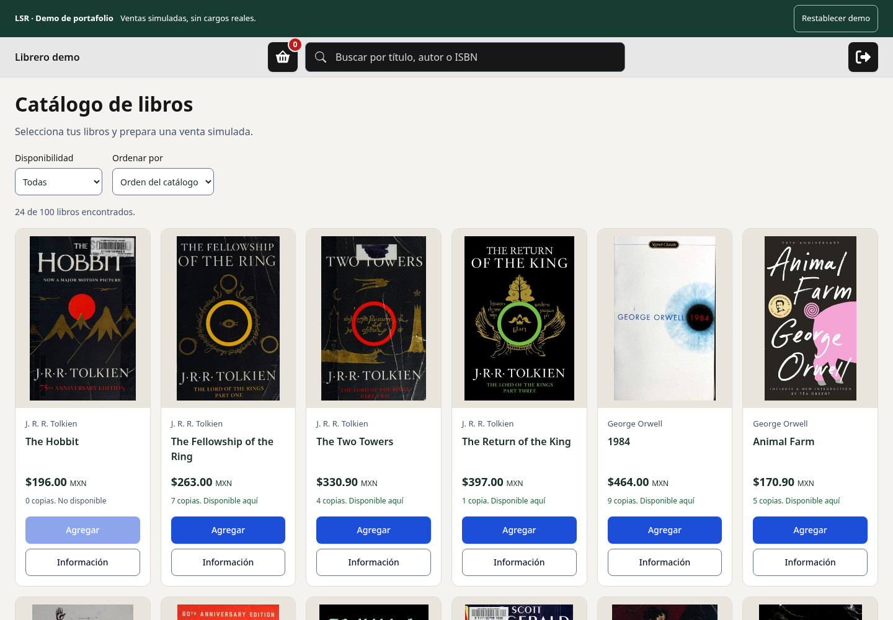
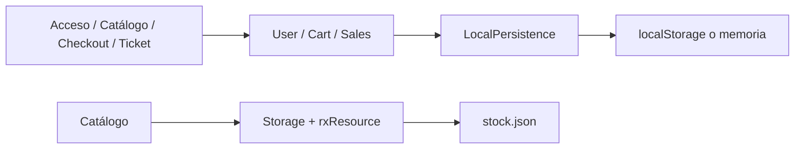
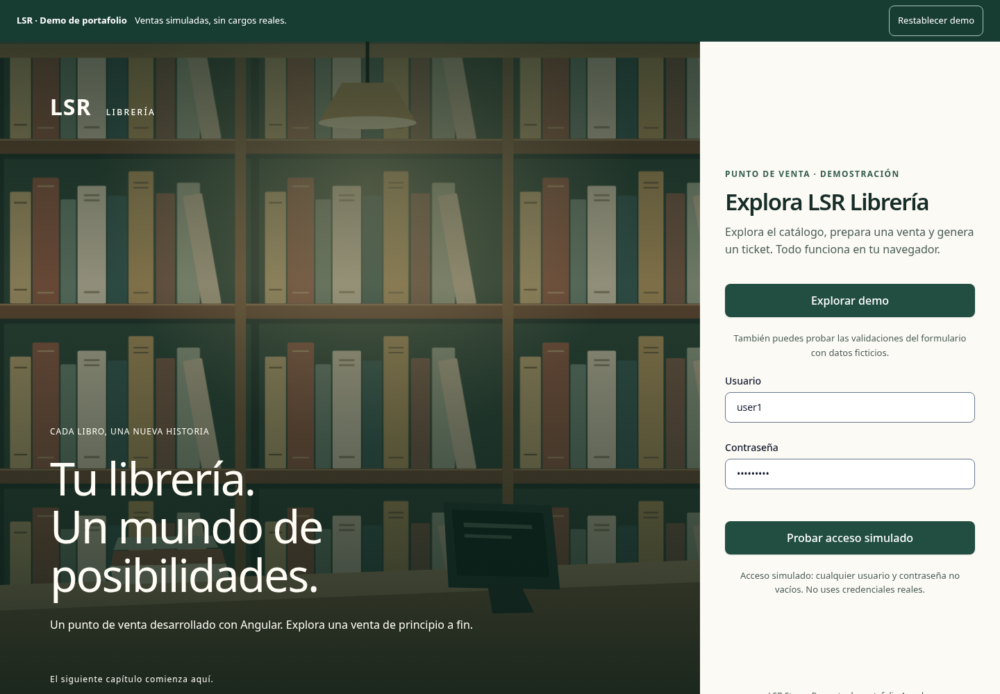
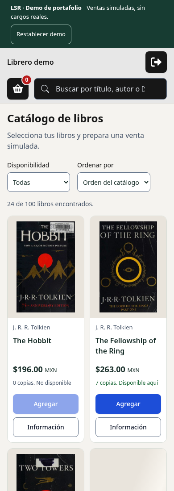
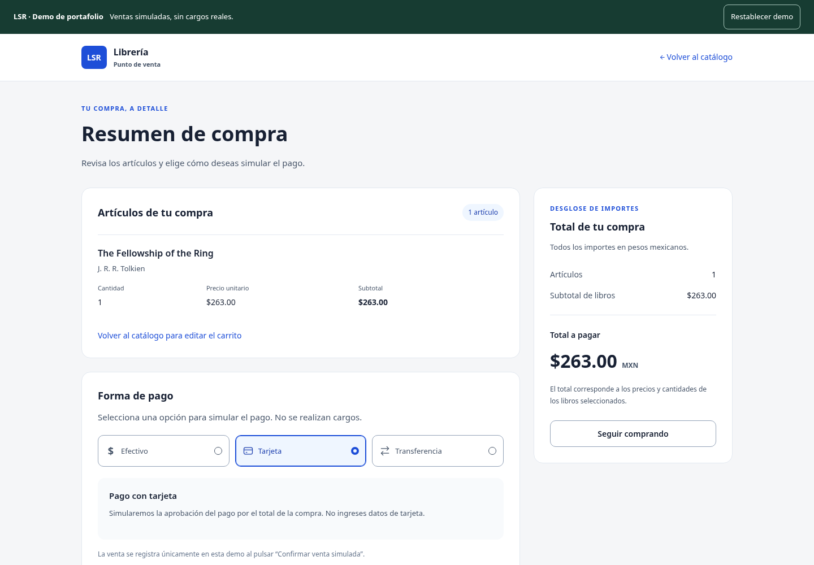
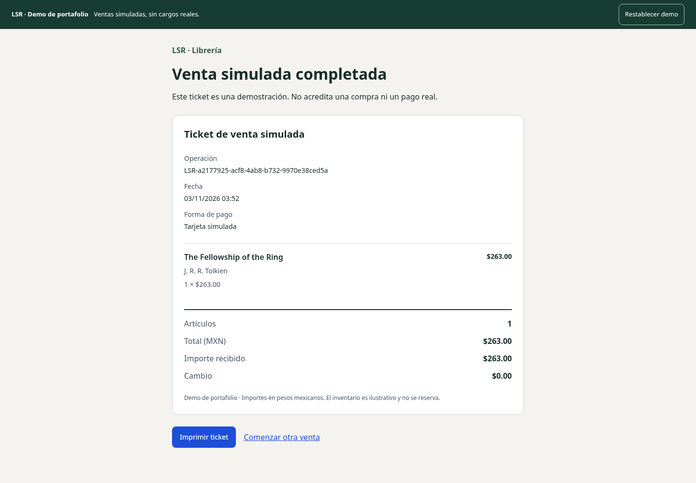

# LSR Librería · Portafolio Angular

Punto de venta de librería construido con **Angular 22, TypeScript estricto y Signals**. Permite explorar un catálogo, preparar una venta y generar un ticket imprimible sin backend.

[](https://github.com/theRobert174/lsr-store/actions/workflows/ci.yml)



## Probar la demo

```bash
pnpm install --frozen-lockfile
pnpm start
```

Abre [localhost:4200](http://localhost:4200) y pulsa **Explorar demo**. También puedes probar el formulario con cualquier usuario y contraseña no vacíos; no uses credenciales reales.

1. Busca por título, autor o ISBN y filtra por disponibilidad.
2. Agrega libros disponibles, cambia cantidades y abre el resumen.
3. En efectivo, introduce un importe suficiente; también puedes elegir tarjeta o transferencia simuladas.
4. Confirma la venta y consulta o imprime el ticket.
5. Recarga: el carrito y los tickets se conservan. **Restablecer demo** borra únicamente los datos de LSR.

La aplicación es una demostración: no autentica usuarios, procesa cargos, reserva existencias ni emite comprobantes fiscales. El stock es ilustrativo. Las últimas 50 ventas permanecen en el navegador; el catálogo ofrece acceso al último ticket. Cada ticket tiene una URL propia que funciona en ese mismo navegador mientras se conserven sus datos.

## Decisiones técnicas

- **Standalone y rutas lazy:** acceso, catálogo, checkout y ticket se cargan por separado.
- **Signals:** estado local, cantidades y totales derivados; `linkedSignal` sincroniza búsqueda y paginación.
- **Signal Forms:** validación del acceso y del importe recibido; los controles reutilizables implementan el contrato de Angular.
- **Datos estáticos:** `Storage` carga y valida `public/stock.json` con `HttpClient` y `rxResource`; incluye estados de carga, error, vacío y reintento.
- **Persistencia separada:** `LocalPersistence` encapsula `localStorage`, claves con prefijo y versión, validación y recuperación. `Cart`, `Sales` y `User` son responsables de sus datos. Si el almacenamiento está bloqueado o sin espacio, la demo funciona en memoria y avisa de su limitación.
- **Importes en centavos:** redondeo del precio unitario y operaciones posteriores con enteros. Los tickets conservan una copia de precios y cantidades de la venta.
- **Estado compartible:** búsqueda, disponibilidad y orden se conservan en los parámetros de la URL.
- **Accesibilidad:** controles nativos, nombres accesibles coherentes con el texto visible, foco al navegar, diálogos con contención y restauración del foco, enlaces para saltar contenido y movimiento reducido.



```text
src/app/
  core/models/         Contrato y validación de libros
  core/auth/           Identidad demostrativa, sin guardar contraseñas
  core/services/       Catálogo, carrito, ventas y persistencia
  features/auth/       Página de acceso demo
  features/seller/     Catálogo, checkout, ticket y sus componentes
  layouts/             Estructura de acceso y catálogo
  shared/              Controles, diálogos y cálculos compartidos
e2e/                   Flujos de usuario y accesibilidad en escritorio/móvil
scripts/preview.mjs    Servidor local de la compilación estática con fallback SPA
```

## Requisitos y comandos

Node **22.23.0+ de la rama 22**, **24.22.0+ de la rama 24** o **26.12.0+ de la rama 26**; pnpm **12.15.0**. CI usa Node 22.23.1. Para el despliegue se ha validado Node 22.23.1.

| Comando                   | Uso                                                          |
| ------------------------- | ------------------------------------------------------------ |
| `pnpm start`              | Desarrollo en el puerto 4200                                 |
| `pnpm build`              | Compilación de producción con presupuestos de tamaño         |
| `pnpm build:cloudflare`   | Compilar y empaquetar los archivos para Cloudflare           |
| `pnpm cloudflare:check`   | Validar el paquete sin publicar                              |
| `pnpm deploy:cloudflare`  | Publicar el paquete preparado tras iniciar sesión            |
| `pnpm preview`            | Vista previa estática en el puerto 4173, después de compilar |
| `pnpm test --watch=false` | Pruebas unitarias con Vitest                                 |
| `pnpm e2e:install`        | Instalar Chromium para Playwright                            |
| `pnpm e2e`                | Flujos E2E contra el servidor de desarrollo                  |
| `pnpm e2e:production`     | Los mismos flujos contra la compilación de producción        |
| `pnpm e2e:typecheck`      | Tipado de las pruebas y su configuración                     |
| `pnpm format:check`       | Comprobar formato                                            |
| `pnpm format`             | Aplicar formato                                              |
| `pnpm screenshots`        | Actualizar las capturas de documentación y la imagen social  |

En Linux CI instala Chromium y sus dependencias con `pnpm exec playwright install --with-deps chromium`. Los servidores E2E usan los puertos 4300 (desarrollo) y 4301 (producción); deben estar libres. Los fallos conservan trazas y capturas en `test-results/` y el informe en `playwright-report/`.

## Validación

Las pruebas unitarias cubren contratos de controles, cantidades inválidas, persistencia dañada o bloqueada, redondeo y registro de ventas. Las E2E usan inventario controlado mediante interceptación de `stock.json`, y una prueba adicional carga los 100 libros reales. Se comprueban búsqueda, filtros, recarga, teclado, cantidades, diálogos, errores/reintento, los tres métodos de pago, tickets y restablecimiento.

Los escaneos AXE cubren acceso y errores de validación, catálogo, diálogos, checkout y ticket en Chromium de escritorio y móvil. Las comprobaciones automáticas se complementan con revisión de capturas y navegación por teclado; no equivalen por sí solas a certificar toda la conformidad WCAG.

GitHub Actions ejecuta formato, pruebas unitarias, tipado, compilación y E2E contra producción. El flujo no publica automáticamente el sitio.

## Publicación estática

La carpeta que se publica es **`dist/lsr-store/browser`**, no `dist/lsr-store`. No se necesitan variables secretas ni una API.

El destino preparado es **Cloudflare Workers Static Assets**, en
`https://libreria.rodrigomartinez.dev`, como proyecto independiente del portafolio en
`rodrigomartinez.dev`. El subdominio es el destino configurado; la publicación requiere
iniciar sesión en la cuenta de Cloudflare.

```bash
pnpm build:cloudflare
pnpm cloudflare:check
pnpm exec cf auth login
pnpm deploy:cloudflare
```

La CLI y el empaquetador oficiales están fijados a versiones exactas porque usan un
formato beta. Angular genera sus archivos habituales; un script los empaqueta para
`cf deploy --prebuilt`, sin añadir backend ni sustituir el compilador de Angular.

Consulta [la guía de despliegue](docs/deployment.md) para conectar GitHub desde el panel,
asociar el subdominio y comprobar las rutas. `ci.yml` conserva las comprobaciones de
calidad; las configuraciones alternativas de Netlify y Vercel se han retirado.

## Capturas

| Acceso                                            | Catálogo móvil                                         |
| ------------------------------------------------- | ------------------------------------------------------ |
|  |  |




## Datos e imágenes

`public/stock.json` contiene 100 registros ilustrativos con precios y disponibilidad ficticios. Las portadas se solicitan a [Open Library Covers](https://openlibrary.org/dev/docs/api/covers); si una imagen falla, se usa una portada local. Las pruebas funcionales no dependen de ese servicio. Las ilustraciones SVG, favicon y componentes de interfaz están incluidos en el repositorio. Las portadas y obras mantienen los derechos de sus titulares.
